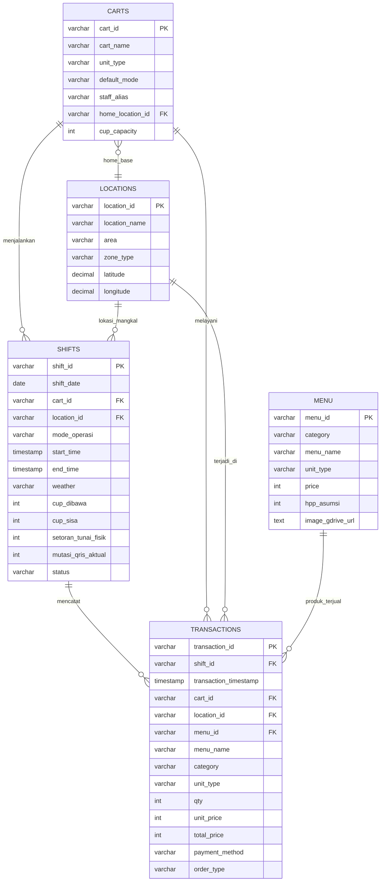

# 02. Skema Relasional & Kamus Data (Data Dictionary)

**Proyek:** Capstone Project Asah 2026 — Tim A26-CS267 (Karsa)  
**Versi Skema:** `v1.0` (Disiapkan Minggu ke-1 sebagai acuan lintas tim DS, FS, dan AE)  
**Periode Dataset Sintetis:** 1 Agustus 2026 – 31 Oktober 2026 (92 hari penuh, zona waktu `Asia/Jakarta` / WIB)

---

## 1. Diagram Relasi Entitas (ERD)

> [!IMPORTANT]
> **Aturan Bisnis Penting pada `unit_type` (Cup vs Botol):**  
> Katalog asli Kopi Sewu mencakup 12 menu satuan `cup` (kategori `Kopi` dan `Non Kopi`) serta 2 menu satuan `botol` (`Botolan 1 Liter` dan `Botolan 250 ml`). Saat menghitung **rekonsiliasi fisik cup per shift** (`cup_terpakai_fisik = cup_dibawa - cup_sisa`), sistem **WAJIB** hanya membandingkannya dengan jumlah transaksi yang memiliki `unit_type = 'cup'`. Transaksi `botol` tetap dihitung dalam total omzet, setoran tunai, dan mutasi QRIS, tetapi tidak mengurangi stok cup.

---

## 2. Kamus Data Tabel Operasional

### 2.1 Tabel `menu` (`menu_gt.csv` / sumber mentah `menu_kopi_sewu_raw.csv`)
Berisi 14 varian produk asli Kopi Sewu.

| Kolom | Tipe Data (PG) | Nullable | Nilai Valid / Format | Sumber Data | Keterangan |
|---|---|---|---|---|---|
| `menu_id` | `VARCHAR(10)` (PK) | Tidak | `MNU-01` s.d. `MNU-14` | Generasi DS | ID unik produk |
| `category` | `VARCHAR(20)` | Tidak | `Kopi`, `Non Kopi`, `Botolan` | **Primer UMKM** | Kategori produk sesuai daftar menu |
| `menu_name` | `VARCHAR(60)` | Tidak | Unik (mis. `Kopi Aren`) | **Primer UMKM** | Nama resmi varian minuman |
| `unit_type` | `VARCHAR(10)` | Tidak | `cup`, `botol` | Turunan DS | Satuan kemasan; penentu perhitungan rekonsiliasi cup |
| `price` | `INTEGER` | Tidak | `15000` – `75000` (IDR) | **Primer UMKM** | Harga jual resmi per satuan |
| `hpp_asumsi` | `INTEGER` | Tidak | `5500` – `36000` (IDR) | **Asumsi DS** | Estimasi HPP per satuan (~42–50% harga jual) untuk simulasi margin |
| `estimated_margin` | `INTEGER` | Tidak | `price - hpp_asumsi` | Turunan DS | Estimasi margin kotor per satuan (IDR) |
| `image_filename` | `VARCHAR(100)` | Ya | mis. `kopi aren.jpeg` | **Primer UMKM** | Nama berkas foto produk |
| `image_gdrive_url` | `TEXT` | Ya | URL Google Drive | **Primer UMKM** | Tautan foto produk untuk antarmuka katalog / POS Frontend |
| `is_available` | `BOOLEAN` | Tidak | `TRUE` / `FALSE` | Operasional | Status ketersediaan menu pada aplikasi POS |
| `price_source` | `VARCHAR(20)` | Tidak | `primer_umkm` | Metadata DS | Penanda transparansi sumber harga |
| `hpp_source` | `VARCHAR(20)` | Tidak | `asumsi_tim_ds` | Metadata DS | Penanda transparansi bahwa HPP adalah asumsi |

---

### 2.2 Tabel `locations` (`locations_gt.csv`)
Berisi 6 titik operasional di koridor Tiban, Sekupang, dan Batam Centre.

| Kolom | Tipe Data (PG) | Nullable | Nilai Valid / Format | Sumber Data | Keterangan |
|---|---|---|---|---|---|
| `location_id` | `VARCHAR(10)` (PK) | Tidak | `LOC-01` s.d. `LOC-06` | Generasi DS | ID unik titik operasional |
| `location_name` | `VARCHAR(80)` | Tidak | Nama titik lokasi | Hybrid* | `LOC-01` primer UMKM; `LOC-02`–`LOC-06` titik landmark sekitar |
| `area` | `VARCHAR(60)` | Tidak | Tiban / Sekupang / Batam Centre | Referensi Geografis | Wilayah administratif / koridor |
| `zone_type` | `VARCHAR(40)` | Tidak | `outlet_olahraga_komunitas`, `komersial_kuliner`, `pasar_perumahan`, `kampus`, `perkantoran_ruang_publik`, `kampus_perkantoran` | Klasifikasi DS | Karakteristik demografi & pola jam ramai titik |
| `latitude` | `DECIMAL(9,6)` | Tidak | `1.106644` – `1.130300` | Google Maps / OSM | Koordinat lintang akurat untuk pin peta Leaflet.js |
| `longitude` | `DECIMAL(9,6)` | Tidak | `103.954898` – `104.053500` | Google Maps / OSM | Koordinat bujur akurat untuk pin peta Leaflet.js |
| `source_status` | `VARCHAR(30)` | Tidak | `primer_umkm` / `asumsi_titik_sekitar_umkm` | Metadata DS | Penanda status keaslian titik |
| `notes` | `TEXT` | Ya | Deskripsi singkat | Metadata DS | Keterangan karakter titik mangkal |

---

### 2.3 Tabel `carts` (`carts_gt.csv`)
Berisi 5 unit operasional (1 outlet tetap + 4 gerobak kopi keliling).

| Kolom | Tipe Data (PG) | Nullable | Nilai Valid / Format | Sumber Data | Keterangan |
|---|---|---|---|---|---|
| `cart_id` | `VARCHAR(10)` (PK) | Tidak | `CRT-00` s.d. `CRT-04` | Generasi DS | `CRT-00` = Outlet Utama; `CRT-01`–`CRT-04` = Gerobak |
| `cart_name` | `VARCHAR(50)` | Tidak | `Outlet Kopi Sewu Tiban`, `Gerobak Sewu 01`..`04` | Hybrid | Nama unit yang tampil di peta & dasbor |
| `unit_type` | `VARCHAR(25)` | Tidak | `outlet_tetap`, `gerobak_keliling` | Klasifikasi DS | Pembeda outlet tetap vs armada bergerak |
| `default_mode` | `VARCHAR(15)` | Tidak | `tetap`, `mangkal`, `keliling` | Klasifikasi DS | Pola operasi utama (mangkal 1 titik vs keliling/muter) |
| `staff_alias` | `VARCHAR(30)` | Tidak | `Staf Outlet`, `Rider A`–`Rider D` | Sintetis (Anonim) | Nama samaran staf tanpa data pribadi asli |
| `home_location_id` | `VARCHAR(10)` (FK) | Tidak | Referensi `locations.location_id` | Sintetis | Titik mangkal utama / basis unit |
| `cup_capacity` | `INTEGER` | Tidak | `75` – `120` | Asumsi DS | Kapasitas bawaan cup tipikal per shift |
| `source_status` | `VARCHAR(30)` | Tidak | `primer_umkm` / `asumsi_armada_sintetis` | Metadata DS | Penanda status sumber data unit armada |

*Catatan integrasi PostgreSQL (`schema_postgresql_reference.sql`):* Tabel `carts` di basis data juga menambahkan 3 kolom *live-tracking* (`is_active`, `current_location_id`, `last_updated_at`) yang dikelola secara dinamis oleh Backend Express (Tim FS) saat staf mengaktifkan/menonaktifkan status mangkal gerobak.

---

### 2.4 Tabel `shifts` (`shifts_raw.csv` & `shifts_gt.csv`)
Mencatat sesi operasional per unit di satu titik lokasi. Gerobak bermode `keliling` dapat memiliki **2 shift pada hari yang sama** di dua lokasi berbeda (mis. sesi pagi di kampus UIB, sesi sore berpindah ke Tiban Centre).

| Kolom | Tipe Data (PG) | Nullable | Nilai Valid / Format | Sumber Data | Keterangan |
|---|---|---|---|---|---|
| `shift_id` | `VARCHAR(20)` (PK) | Tidak | `SHF-YYYYMMDD-NNNN` | Sintetis DS | ID unik sesi mangkal |
| `shift_date` | `DATE` | Tidak | `YYYY-MM-DD` | Sintetis DS | Tanggal operasional shift |
| `cart_id` | `VARCHAR(10)` (FK) | Tidak | Referensi `carts.cart_id` | Sintetis DS | Unit yang beroperasi |
| `location_id` | `VARCHAR(10)` (FK) | Tidak | Referensi `locations.location_id` | Sintetis DS | Titik lokasi operasional selama shift |
| `mode_operasi` | `VARCHAR(15)` | Tidak | `tetap`, `mangkal`, `keliling` | Sintetis DS | Mode operasi pada shift tersebut |
| `start_time` | `TIMESTAMP` | Tidak | `YYYY-MM-DD HH:MM:SS` | Sintetis DS | Waktu mulai buka / aktif di titik |
| `end_time` | `TIMESTAMP` | Tidak | `YYYY-MM-DD HH:MM:SS` (`> start_time`) | Sintetis DS | Waktu selesai / tutup shift |
| `weather` | `VARCHAR(15)` | Tidak | `Cerah`, `Berawan`, `Hujan` | Sintetis DS | Kondisi cuaca dominan saat shift di Batam |
| `cup_dibawa` | `INTEGER` | Tidak | `>= 0` | Sintetis DS | Jumlah stok cup fisik saat memulai shift |
| `cup_sisa` | `INTEGER` | Ya (di raw) | `0 <= cup_sisa <= cup_dibawa` | Sintetis DS | Sisa fisik cup saat tutup shift (di raw sengaja ada `NaN` karena lupa input) |
| `setoran_tunai_fisik` | `INTEGER` | Tidak | `>= 0` (IDR) | Sintetis DS | Total uang tunai fisik yang disetorkan rider ke pemilik |
| `mutasi_qris_aktual` | `INTEGER` | Tidak | `>= 0` (IDR) | Sintetis DS | Total mutasi masuk QRIS aktual untuk shift tersebut |
| `status` | `VARCHAR(15)` | Tidak | `aktif`, `selesai` | Sintetis DS | Status shift (seluruh data historis berstatus `selesai`) |

**Rumus Metrik Turunan Rekonsiliasi Shift:**
- `cup_terpakai_fisik = cup_dibawa - cup_sisa` *(bernilai `NULL` jika `cup_sisa` kosong — jangan di-impute 0!)*
- `cup_tercatat_sistem = SUM(transactions.qty WHERE unit_type = 'cup')`
- `selisih_cup = cup_terpakai_fisik - cup_tercatat_sistem` *(positif berarti lebih banyak cup fisik keluar dibanding catatan nota/sistem → indikasi transaksi terlewat dicatat atau cup rusak)*
- `selisih_tunai = setoran_tunai_fisik - SUM(transactions.total_price WHERE payment_method = 'Tunai')`
- `selisih_qris = mutasi_qris_aktual - SUM(transactions.total_price WHERE payment_method = 'QRIS')`

---

### 2.5 Tabel `transactions` (`transactions_raw.csv` & `transactions_gt.csv`)
Mencatat setiap item transaksi penjualan.

| Kolom | Tipe Data (PG) | Nullable | Nilai Valid / Format | Sumber Data | Keterangan |
|---|---|---|---|---|---|
| `transaction_id` | `VARCHAR(15)` (PK) | Tidak | `TRX-000001` dst. | Sintetis DS | ID unik transaksi |
| `shift_id` | `VARCHAR(20)` (FK) | Tidak | Referensi `shifts.shift_id` | Sintetis DS | Sesi shift tempat transaksi terjadi |
| `transaction_timestamp` | `TIMESTAMP` | Tidak | `YYYY-MM-DD HH:MM:SS` | Sintetis DS | Waktu transaksi (di raw sebagian berformat `DD/MM/YYYY HH:MM`) |
| `cart_id` | `VARCHAR(10)` (FK) | Tidak | Referensi `carts.cart_id` | Sintetis DS | Unit penjual |
| `location_id` | `VARCHAR(10)` (FK) | Tidak (Ya di raw) | Referensi `locations.location_id` | Sintetis DS | Titik lokasi transaksi (jika kosong di raw, dapat di-impute dari `shifts.location_id`) |
| `menu_id` | `VARCHAR(10)` (FK) | Tidak | Referensi `menu.menu_id` | Sintetis DS | Referensi produk |
| `menu_name` | `VARCHAR(60)` | Tidak | Sesuai `menu.menu_name` | Sintetis DS | Nama menu saat tercatat (di raw mengandung typo/inkonsistensi spasi & huruf besar) |
| `category` | `VARCHAR(20)` | Tidak | `Kopi`, `Non Kopi`, `Botolan` | Sintetis DS | Kategori menu |
| `unit_type` | `VARCHAR(10)` | Tidak | `cup`, `botol` | Sintetis DS | Satuan produk |
| `qty` | `INTEGER` | Tidak | `>= 1` | Sintetis DS | Jumlah pembelian (di raw terdapat beberapa nilai `<= 0` untuk diuji saat cleaning) |
| `unit_price` | `INTEGER` | Tidak (Ya di raw) | Sesuai `menu.price` (IDR) | Sintetis DS | Harga per unit (di raw ada yang hilang atau typo 0.1x/10x; dapat dikoreksi via `menu_id`) |
| `total_price` | `INTEGER` | Tidak | `qty * unit_price` (IDR) | Turunan | Nilai total transaksi |
| `hpp_asumsi_total` | `INTEGER` | Tidak | `qty * menu.hpp_asumsi` | Turunan (GT/Clean) | Estimasi total HPP transaksi (hanya ditambahkan setelah proses cleaning) |
| `payment_method` | `VARCHAR(10)` | Tidak (Ya di raw) | `Tunai`, `QRIS` | Sintetis DS | Metode pembayaran (di raw ada inkonsistensi `CASH`/`qris` dan `NaN`) |
| `order_type` | `VARCHAR(15)` | Tidak | `reguler`, `bulk_order` | Sintetis DS | Penanda pesanan reguler vs pesanan besar/acara (outlier valid) |

---

## 3. Kamus Data Dataset Klasifikasi Intent (Handoff Tim AE)

Disimpan di `data-science/data/ai_handoff/`:
- `intent_dataset_full.csv` (360 baris)
- `intent_train.csv` (252 baris / 70%)
- `intent_val.csv` (55 baris / 15%)
- `intent_test.csv` (53 baris / 15%)
- `guardrail_out_of_context_eval_15.csv` (15 baris uji khusus di luar konteks)

| Kolom | Tipe Data | Nilai Valid | Keterangan |
|---|---|---|---|
| `query_id` | `VARCHAR(10)` | `QRY-0001` – `QRY-0360` | ID unik pertanyaan |
| `text` | `TEXT` | Teks bahasa Indonesia (formal & kasual) | Pertanyaan pengguna ke Asisten Cerdas Kopi Sewu |
| `intent` | `VARCHAR(40)` | 6 kelas intent (lihat daftar di bawah) | Label target untuk pelatihan model klasifikasi AI |
| `source` | `VARCHAR(20)` | `sintetis_tim_ds` | Penanda sumber dataset sintetis |

**Daftar 6 Kelas Intent & Fungsinya dalam Routing AI:**
1. `tanya_omzet_penjualan` (80 contoh) → Routing ke ringkasan omzet harian/mingguan/bulanan & margin.
2. `tanya_performa_gerobak_lokasi` (70 contoh) → Routing ke ranking gerobak, performa lokasi, & *peak hours*.
3. `tanya_menu_produk` (60 contoh) → Routing ke katalog harga, menu terlaris, kategori, & margin menu.
4. `tanya_rekonsiliasi_setoran` (50 contoh) → Routing ke laporan selisih cup, setoran tunai, & rasio QRIS.
5. `tanya_rekomendasi_operasional` (50 contoh) → Routing ke ringkasan insight strategis, alokasi armada, & prediksi stok cup.
6. `di_luar_konteks` (50 contoh + 15 uji *guardrails* terpisah) → Routing ke penolakan sopan (*guardrail*) tanpa memanggil query basis data bisnis.
