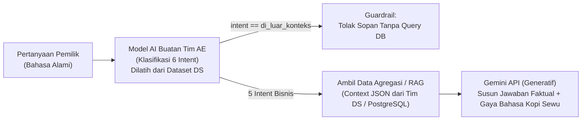

# 04. Kontrak Data & Daftar Serah Terima (Handoff) untuk Tim FS dan Tim AE

**Proyek:** Capstone Project Asah 2026 — Tim A26-CS267 (Karsa)  
**Versi Kontrak:** `v1.0` (Bahan Kesepakatan Lintas Learning Path Minggu ke-1)  
**Penanggung Jawab:** Divisi Data Science (Dwiyan Achmad Assidiqie & Noval Berauh)

Dokumen ini menjelaskan secara rinci **apa saja yang diserahkan Tim Data Science (DS)** kepada **Tim AI Full-Stack Developer (FS)** dan **Tim Next-Gen AI Engineer (AE)**, kapan diserahkan, formatnya, serta aturan penggunaannya agar integrasi akhir Minggu ke-3 berjalan mulus tanpa ketidakcocokan skema.

---

## 1. Handoff untuk Tim Full-Stack (FS) — Grivin & Adlan

### 1.1 Daftar Aset yang Diberikan DS → FS
| No | Aset / File | Waktu Serah Terima | Kegunaan bagi Tim FS |
|---|---|---|---|
| **1** | **Skema Database & Kamus Data** ([02_kamus_data.md](02_kamus_data.md) & [schema_postgresql_reference.sql](../config/schema_postgresql_reference.sql)) | **Minggu 1 (Siap sekarang)** | Acuan langsung pembuatan tabel PostgreSQL di Supabase/Neon serta validasi input Joi/Zod di Express.js. |
| **2** | **Master Data Seeding** (`menu_gt.csv`, `locations_gt.csv`, `carts_gt.csv` — atau versi clean Minggu 2) | **Minggu 1 (Master siap) / Minggu 2 (Clean final)** | Mengisi data awal katalog 14 menu ASLI Kopi Sewu (termasuk link gambar Google Drive), 6 titik koordinat Leaflet.js (Tiban–Sekupang–Batam Centre), dan 5 unit armada. |
| **3** | **Data Historis Clean untuk Seeding DB** (`shifts_clean.csv` & `transactions_clean.csv` — 92 hari) | **Minggu 2 (setelah Data Wrangling selesai)** | Mengisi database staging/production agar dasbor pemilik langsung menampilkan data realistis saat demo ke Kak Olivia. |
| **4** | **Kontrak Format JSON Output Analitik** (Bagian 1.2 di bawah) + **File JSON/SQL Agregasi Tervalidasi** | **Minggu 1 (Kontrak) & Minggu 2 (Data tervalidasi)** | Format baku respon endpoint dasbor Express (`/api/v1/dashboard/...`) agar Frontend React bisa langsung merender KPI card, grafik tren, *peak-hours heatmap*, dan tabel rekonsiliasi (bahkan memakai mock JSON dulu sejak Minggu 1). |
| **5** | **Aturan Validasi Input Bisnis** (Bagian 1.3 di bawah) | **Minggu 1 (Siap sekarang)** | Menjaga agar form input staf gerobak di Frontend & Joi Express tidak memasukkan data korup baru (mis. `qty <= 0`, harga salah ketik, atau lokasi kosong). |
| **6** | **Ringkasan Insight & Prediksi Stok Cup** *(Side Quest DS #3)* | **Minggu 2–3** | Kartu rekomendasi operasional & perkiraan kebutuhan stok cup harian untuk ditampilkan di Dasbor Pemilik. |

### 1.2 Kontrak JSON Endpoint Dasbor Pemilik (DS ↔ FS)
Tim FS dapat langsung merancang komponen grafik React dan endpoint Express dengan kontrak JSON berikut *(angka di bawah merupakan ilustrasi struktur payload; data aktual hasil agregasi clean diserahkan pada Minggu ke-2)*:

#### A. `GET /api/v1/dashboard/summary?start_date=2026-10-01&end_date=2026-10-31&cart_id=ALL`
```json
{
  "meta": {
    "start_date": "2026-10-01",
    "end_date": "2026-10-31",
    "cart_id": "ALL",
    "data_label": "DATA SINTETIS (SIMULASI CAPSTONE)"
  },
  "kpi": {
    "total_revenue_idr": 178500000,
    "estimated_gross_profit_idr": 96200000,
    "gross_margin_pct": 53.9,
    "total_transactions": 6610,
    "total_cups_sold": 9740,
    "total_bottles_sold": 245,
    "avg_order_value_idr": 27004,
    "qris_share_pct": 56.4,
    "cash_share_pct": 43.6,
    "shifts_with_cup_discrepancy": 36,
    "total_unrecorded_cups": 84
  },
  "daily_trend": [
    {
      "date": "2026-10-01",
      "revenue_idr": 5420000,
      "cups_sold": 298,
      "bottles_sold": 7,
      "transactions": 201,
      "weather": "Cerah"
    }
  ]
}
```

#### B. `GET /api/v1/dashboard/locations-and-carts?start_date=...&end_date=...`
```json
{
  "location_ranking": [
    {
      "location_id": "LOC-05",
      "location_name": "Alun-Alun Engku Putri Batam Centre",
      "zone_type": "perkantoran_ruang_publik",
      "latitude": 1.1303,
      "longitude": 104.0535,
      "total_shifts": 98,
      "total_active_hours": 820.5,
      "total_revenue_idr": 134449000,
      "revenue_per_hour_idr": 163862,
      "cups_per_hour": 8.9
    }
  ],
  "cart_comparison": [
    {
      "cart_id": "CRT-01",
      "cart_name": "Gerobak Sewu 01",
      "default_mode": "mangkal",
      "total_shifts": 89,
      "total_revenue_idr": 90600000,
      "total_cups_sold": 5103,
      "avg_revenue_per_hour_idr": 95200,
      "reconciliation_accuracy_pct": 83.1
    }
  ]
}
```

#### C. `GET /api/v1/dashboard/peak-hours`
```json
{
  "heatmap": [
    {
      "zone_type": "kampus",
      "day_type": "weekday",
      "hour": 12,
      "avg_transactions_per_shift_hour": 5.4,
      "avg_cups_per_shift_hour": 8.1
    }
  ]
}
```

#### D. `GET /api/v1/dashboard/top-menus?category=ALL`
```json
{
  "menus": [
    {
      "menu_id": "MNU-07",
      "menu_name": "Kopi Aren",
      "category": "Kopi",
      "unit_type": "cup",
      "price": 18000,
      "qty_sold": 4771,
      "total_revenue_idr": 85878000,
      "estimated_profit_idr": 47710000,
      "revenue_share_pct": 16.3
    }
  ]
}
```

#### E. `GET /api/v1/dashboard/reconciliation?start_date=...&end_date=...`
```json
{
  "summary": {
    "total_shifts": 612,
    "matched_shifts": 490,
    "discrepancy_shifts": 112,
    "incomplete_shifts": 10,
    "total_cup_diff": 258,
    "total_cash_diff_idr": 1850000
  },
  "shift_details": [
    {
      "shift_id": "SHF-20261015-0512",
      "shift_date": "2026-10-15",
      "cart_id": "CRT-02",
      "location_name": "Kawasan Kampus UIB (Baloi - Sei Ladi)",
      "cup_dibawa": 80,
      "cup_sisa": 24,
      "cup_terpakai_fisik": 56,
      "cup_tercatat_sistem": 53,
      "selisih_cup": 3,
      "setoran_tunai_fisik": 420000,
      "expected_tunai_sistem": 366000,
      "selisih_tunai_idr": 54000,
      "selisih_qris_idr": 0,
      "reconciliation_status": "selisih_tinggi"
    }
  ]
}
```
*Aturan status rekonsiliasi:*
- `data_tidak_lengkap` jika `cup_sisa IS NULL`
- `cocok` jika `selisih_cup == 0` dan `ABS(selisih_tunai_idr) <= 5000`
- `perlu_cek` jika `ABS(selisih_cup) BETWEEN 1 AND 2` atau `ABS(selisih_tunai_idr) BETWEEN 5001 AND 30000`
- `selisih_tinggi` jika `ABS(selisih_cup) >= 3` atau `ABS(selisih_tunai_idr) > 30000`

### 1.3 Aturan Validasi Input untuk Form Staf & Joi/Zod Express
Agar data operasional baru yang masuk melalui web tidak mengulangi kotoran yang ditemukan di dataset mentah:
1. `menu_id` wajib dipilih dari dropdown/tombol cepat master menu; `unit_price`, `category`, `unit_type`, dan `total_price` **WAJIB dihitung di server (Express)** dari tabel `menu`, bukan diketik manual oleh staf.
2. `qty` bertipe integer, wajib `>= 1` dan `<= 100` (jika `>= 15`, otomatis tandai `order_type = 'bulk_order'`).
3. `payment_method` wajib enum ketat: `'Tunai'` atau `'QRIS'`.
4. `location_id` wajib terisi ketika status gerobak diubah menjadi `aktif` (menggunakan pilihan dropdown 6 titik reguler atau koordinat aktif yang dipetakan ke titik terdekat).
5. Saat tutup shift, `cup_sisa` wajib integer `>= 0` dan `<= cup_dibawa`, serta `end_time > start_time`.

---

## 2. Handoff untuk Tim Next-Gen AI Engineer (AE) — Irfan & Alifia

### 2.1 Mengapa Tim DS Menyiapkan Dataset Khusus untuk Tim AE?
Berdasarkan *Checklist Tech Stack Gen AI (Main Quest)*:
- Tim AE **DILARANG** hanya memanggil Gemini API / ChatGPT API secara langsung sebagai pengganti model AI yang dibangun sendiri.
- Tim AE **WAJIB** membangun & melatih model AI sendiri menggunakan data yang disediakan Tim DS, menerapkan preprocessing, membandingkan minimal 2 model/konfigurasi dengan metrik yang sama, dan men-serve modelnya lewat FastAPI.
- Gemini API digunakan sebagai **komponen generatif pelengkap** (merangkai jawaban bahasa alami berbasis data/RAG setelah intent diklasifikasikan oleh model buatan tim sendiri).

Oleh karena itu, arsitektur kolaborasi DS → AE dirancang sebagai **Intent-Routed Analytics Assistant**:



### 2.2 Daftar Aset yang Diberikan DS → AE
| No | Aset / File | Lokasi | Waktu Serah Terima | Kegunaan bagi Tim AE |
|---|---|---|---|---|
| **1** | **Dataset Klasifikasi Intent (Train / Val / Test Split Bebas Leakage)** | `data-science/data/ai_handoff/` (`intent_train.csv` [252], `intent_val.csv` [55], `intent_test.csv` [53], `intent_dataset_full.csv` [360]) | **Minggu 1 (Siap sekarang!)** | Melatih & mengevaluasi **model AI utama (Main Quest AE)**, misalnya membandingkan `TF-IDF + Logistic Regression` vs `TF-IDF + LinearSVC` vs `Random Forest / IndoBERT` menggunakan metrik **Macro F1-Score** dan **Confusion Matrix**. Juga memenuhi Side Quest cek keseimbangan kelas (distribusi 80/70/60/50/50/50). |
| **2** | **Dataset Uji Guardrails Di Luar Konteks (15 Kueri Jebakan)** | `data-science/data/ai_handoff/guardrail_out_of_context_eval_15.csv` | **Minggu 1 (Siap sekarang!)** | Memenuhi Side Quest AE & Rencana Pengujian Minggu 4 (*"uji minimal 10 pertanyaan di luar konteks dan tulis hasilnya di README"*). Mencakup jebakan *near-domain* (resep kopi, kompetitor, wisata Batam) dan *prompt injection*. |
| **3** | **Context Knowledge Base JSON (Hasil Agregasi Tervalidasi)** | `data-science/data/processed/ai_context_summary.json` | **Minggu 2 (setelah EDA & Cleaning selesai)** | Dokumen fakta terstruktur (ringkasan omzet, katalog 14 menu + harga, ranking 6 lokasi & *peak hours*, statistik rekonsiliasi, & rekomendasi DS) untuk *retrieval* (RAG / ChromaDB / FAISS) atau *context injection* ke prompt Gemini agar **tidak halusinasi angka**. |
| **4** | **Data Operasional Clean (`transactions_clean.csv`, `shifts_clean.csv`, `menu_clean.csv`)** | `data-science/data/processed/` | **Minggu 2** | Referensi tambahan jika FastAPI melakukan query langsung ke database PostgreSQL untuk kueri dinamis (mis. filter tanggal spesifik). |
| **5** | **Kamus Data & Panduan Anti-Leakage** | [02_kamus_data.md](02_kamus_data.md) | **Minggu 1 (Siap sekarang!)** | Dokumentasi kolom, definisi 6 intent, serta aturan pemakaian split agar evaluasi valid secara ilmiah. |

### 2.3 Panduan Penggunaan Split Dataset untuk Tim AE (Anti Data Leakage)
1. **Hanya `fit()` pada `intent_train.csv`:** Seluruh *vectorizer* (TF-IDF, tokenizer, oversampler/SMOTE jika dipakai) **WAJIB** di-`fit()` hanya pada `intent_train.csv`, lalu di-`transform()` ke `intent_val.csv` dan `intent_test.csv`.
2. **Pemilihan Model & Hyperparameter Tuning:** Gunakan `intent_val.csv` (atau Stratified K-Fold CV di dalam `intent_train.csv`) untuk membandingkan minimal 2 model/konfigurasi (mis. Logistic Regression vs LinearSVC vs MultinomialNB / Random Forest).
3. **Evaluasi Akhir:** Laporkan metrik akhir (Macro F1-Score, Weighted F1-Score, Per-Class Precision/Recall, dan Confusion Matrix) pada `intent_test.csv` yang belum pernah disentuh saat tuning.
4. **Pengujian Guardrail:** Jalankan seluruh 15 kueri pada `guardrail_out_of_context_eval_15.csv` melalui endpoint FastAPI akhir (`POST /api/v1/ai/chat` atau `POST /predict-intent`) dan dokumentasikan tingkat keberhasilan penolakannya di `README.md`.

### 2.4 Contoh Kontrak Request/Response Layanan FastAPI (AE ↔ FS)
Tim DS merekomendasikan struktur endpoint berikut agar hasil klasifikasi intent dan jawaban generatif saling terhubung rapi:

- **`POST /predict-intent`** *(Menunjukkan model AI buatan sendiri — sesuai contoh Side Quest AE)*
  - Request: `{ "text": "Jam berapa paling ramai di Tiban Centre?" }`
  - Response: `{ "intent": "tanya_performa_gerobak_lokasi", "confidence": 0.92, "model_version": "tfidf-linearsvc-v1" }`

- **`POST /chat`** *(Dipanggil dari Backend Express, bukan langsung dari Frontend)*
  - Request: `{ "session_id": "sess-001", "question": "Berapa total omzet minggu ini dan menu apa yang paling laris?", "date_range": { "start": "2026-10-25", "end": "2026-10-31" } }`
  - Response:
    ```json
    {
      "intent": "tanya_omzet_penjualan",
      "confidence": 0.94,
      "is_out_of_context": false,
      "answer": "Berdasarkan data simulasi periode 25–31 Oktober 2026, total omzet Kopi Sewu mencapai ...",
      "data_sources_used": ["kpi_summary", "top_menus"],
      "fallback_used": false
    }
    ```

---

## 3. Jadwal Sinkronisasi Lintas Tim

| Minggu | Deliverables DS yang Diserahkan | Penerima |
|---|---|---|
| **Minggu 1 (20–26 Nov)** | Dokumen 01–04, skema SQL referensi, master data menu & lokasi, dataset raw & ground truth, **dataset klasifikasi intent (train/val/test) + 15 kueri guardrails**. | FS & AE |
| **Minggu 2 (27 Nov–3 Des)** | Notebook Data Wrangling & EDA lengkap, dataset `processed/*_clean.csv`, modul agregasi Python/SQL, `ai_context_summary.json` (RAG knowledge base), & temuan/rekomendasi bisnis. | FS & AE |
| **Minggu 3 (4–10 Des)** | Model prediksi kebutuhan cup harian (*Side Quest DS #3*), integrasi penuh dasbor + seeding data ke PostgreSQL produksi, & validasi ketepatan angka dasbor serta jawaban AI terhadap ground truth. | FS & AE |
| **Minggu 4 (11–22 Des)** | Pengujian edge cases data (missing/kosong/tanggal tanpa transaksi), dukungan sesi demo ke Kak Olivia, dan finalisasi dokumentasi README divisi DS. | Seluruh Tim |
